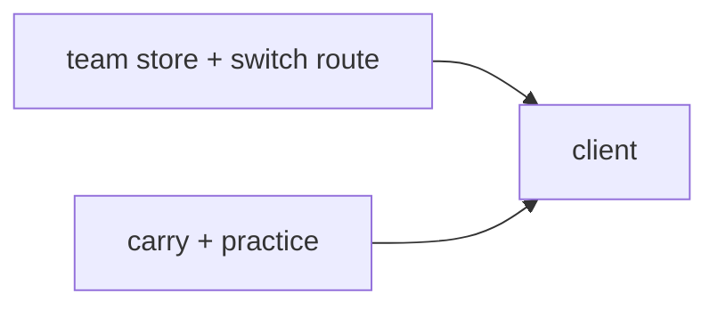
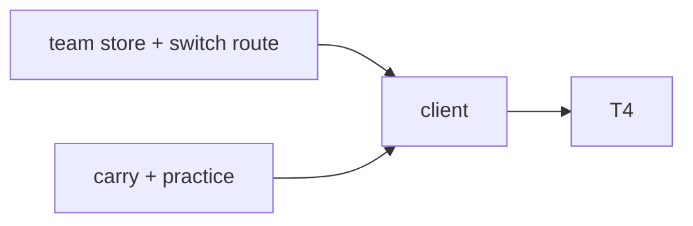

# Integration plan: team saves per case

**Goal:** a team never loses a case's progress by switching cases; Restart clears interviews but keeps counting coins; a replay of a solved case is practice and never scores.
**Architecture:** teams.mjs keeps caseId -> sessionId per team. A new POST /api/switch in index.mjs resumes the team's saved session of a case, or starts a fresh one (a `start` on a new game, never a `reset` of the old session, because a `session_reset` event makes a log unloadable in replay()). session.mjs carries coins across a same-case reset in `wallet.carried` and marks resets of a closed session as `practice`; leaderboard.mjs skips practice sessions. The client sends `switch` for case changes and shows a practice tag.
**Tech stack:** Node 22+ ESM, node:test, TypeScript client with Vite, no new deps.
**Detail:** contracts
**Target-min:** 20
**Ignore:** docs/plans/, demos/override/node_modules, demos/override/dist

## Global constraints

- WT = /Users/williambrach/Developer/AgentVerse/.claude/worktrees/team-saves (branch worktree-team-saves from main 878b1ef). Work only in WT with absolute paths. App root `WT/demos/override`.
- Unit tests: `cd WT/demos/override && node --test tests/<file>.test.mjs`. No Playwright in this run. Never run the whole unit suite at the same time as another suite.
- Production has no coin budget (`economyRules` budget null); tests may pass a budget.
- `spend.total` and `verdict_submitted.coins.spent` stay per-session numbers: the leaderboard sums them across a case's sessions (server/leaderboard.mjs row()). Never put carried coins into a logged total.
- A `session_reset` event inside a session log makes `replay()` return null. Only an explicit Restart may log it; switching cases must never reset the session being left.
- Client text: new strings go in `client/text/<area>.json` as `<area>.<name>`, used through `t()`/`plain()`; tests/text-keys.test.mjs must pass.
- Keep green: teams, session, session-team, http, coins-http, economy, leaderboard (admin-leaderboard), text-keys, hud-ui.

## File structure

| File | Responsibility |
|---|---|
| server/teams.mjs | per-team caseId -> sessionId map, persisted in team_session records |
| server/index.mjs | POST /api/switch; attach with caseId after every mutation |
| server/session.mjs | wallet.carried, session.practice, replay of both, view coin total |
| server/economy.mjs | carried in createWallet and quote |
| server/leaderboard.mjs | ignore practice sessions |
| client/main.ts | switch action for case changes, practice tag |

## Task graph

## Server

**Probe entry:** call=teams.createTeams

### T1 team store + switch route · Complexity 6 · Est. context 45k
**Owns:** demos/override/server/teams.mjs, demos/override/server/index.mjs, demos/override/tests/teams.test.mjs, demos/override/tests/team-switch-http.test.mjs
**Components:** 2
**LOC owned:** 140
**Tests:** fast
**Kind:** design
**Model:** sonnet
**Consumes:** none
**Produces:** teams.attach(id, sessionId, caseId?) -> void · teams.sessionFor(id, caseId) -> string|null · teams.find(id) -> {id, name, sessionId, sessions: Record<caseId, sessionId>}|null · POST /api/switch {caseId} -> CaseState view
e.g. A team plays banana (session s1), POST /api/switch {caseId:'tower'} -> new session s2 for tower; POST /api/switch {caseId:'banana'} -> view of s1 with its interviews and economy; /api/state then returns s1.
**Review Focus:** correctness, data-integrity. `no_reset_on_switch`: switching to a case without a saved game creates it with `investigations.mutate(null, 'start', {caseId}, {team})` (a new game), never `reset` on the current session; the left session's log gains no event. `resume`: a saved session is made current with `teams.attach` and answered with `investigations.view(id)`; it takes no new-game rate slot. `legacy`: team_session records without caseId restore only the current sessionId; when `sessions` lacks the case but the current session's caseId matches, the current session is resumed. `attach_everywhere`: index.mjs `teams.attach(team.id, view.session.id, view.session.caseId)` after every team mutation, and attach is a no-op (no file line) when nothing changed. `unknown_case`: 400 'Unknown case.' like reset. `no_team`: without a team, switch behaves as today's reset {caseId}.
**Steps:** read server/teams.mjs, server/index.mjs (route block ~lines 86-190), server/session.mjs Investigations.find/view/mutate. Failing tests first (tests/teams.test.mjs for the store; new tests/team-switch-http.test.mjs with createApp over a temp data dir, see tests/http.test.mjs and tests/session-team.test.mjs for setup). Implement, pass; also run tests/http.test.mjs, tests/coins-http.test.mjs, tests/session-team.test.mjs.
**Notes:** route `/api/switch` goes in the `route` label list and is handled before the generic POST action block. Do not add `switch` to Investigations.

### T2 carry + practice · Complexity 6 · Est. context 50k
**Owns:** demos/override/server/session.mjs, demos/override/server/economy.mjs, demos/override/server/leaderboard.mjs, demos/override/tests/team-carry.test.mjs
**Components:** 3
**LOC owned:** 120
**Tests:** fast
**Kind:** design
**Model:** sonnet
**Consumes:** none
**Produces:** view().session.economy.spent = carried + spent (number shown to players) · view().session.economy.carried: number · view().session.practice: boolean · session_started event fields `economy.carried` (via wallet) and `practice: boolean`
e.g. banana session with 5 coins spent, Restart (reset) -> new session economy {spent shown 5, carried 5}; ask once -> shown 6, logged spend.total 1. After a verdict, Restart -> practice true, shown 0.
**Review Focus:** correctness, data-integrity. `carry_rule`: on `reset`, when the old session's caseId equals the new case and it has no verdict, carried = old.carried + old.spent and practice = old.practice; when the old session has a verdict (any outcome, incl. escaped) practice = true and carried = 0; a different case -> carried 0, practice false. `per_session_totals`: spend.total and verdict coins.spent stay per-session. `replay`: replay() restores carried and practice from session_started; old logs without them -> 0/false. `quote_budget`: with a budget, quote() checks budget - spent - carried. `leaderboard_skip`: leaderboard.observe ignores a session_started with practice true (no team/case entry, not in live), so its events never count. `view_only`: the coin total is changed only in the view clone, never in the stored wallet.
**Steps:** read server/session.mjs (replay ~85-140, mutate ~430-505, start ~512, view ~313), server/economy.mjs, server/leaderboard.mjs. Failing tests in tests/team-carry.test.mjs (Investigation/Investigations over a temp dir in rehearsal mode, see tests/session.test.mjs; leaderboard via createLeaderboard with synthetic events, see the existing leaderboard tests). Implement, pass; also run tests/session.test.mjs, tests/economy.test.mjs, tests/admin-leaderboard.test.mjs, tests/deadline.test.mjs.

## Client

### T3 client · Complexity 4 · Est. context 45k
**Owns:** demos/override/client/main.ts, demos/override/client/hud.ts, demos/override/client/types.ts, demos/override/client/hud.css, demos/override/client/text/main.json, demos/override/client/text/hud.json, demos/override/tests/team-saves-ui.test.mjs
**Components:** 2
**LOC owned:** 70
**Tests:** fast
**Kind:** design
**Model:** sonnet
**Consumes:** POST /api/switch {caseId}, view().session.practice, view().session.economy.carried
**Produces:** client behaviour only
e.g. case switcher confirm and the debrief's next-case button POST /api/switch; Restart keeps POST /api/reset; a practice session shows a "Practice, not scored" tag in the HUD.
**Review Focus:** correctness, text. `switch_paths`: startCase is split so `confirm-reset` and `next-case` (main.ts ~570-572) use action('switch', {caseId}) and `confirm-restart` keeps action('reset', {caseId}); the fresh() view reset still runs for both. `copy`: the case-switch confirm says progress in the current case is saved; the restart confirm says interviews clear and the coin count keeps going; strings live in text json via t(). `practice_tag`: shown only when state.session?.practice. types.ts Economy gains `carried?: number`, Session gains `practice?: boolean`.
**Steps:** read client/main.ts startCase/onClick/case switcher modal and confirm-restart modal (~line 1015), client/hud.ts, client/text/main.json and hud.json, tests/hud-ui.test.mjs. Put the tag markup in an exported pure helper in hud.ts and unit-test it in tests/team-saves-ui.test.mjs. Implement; run tests/text-keys.test.mjs, tests/hud-ui.test.mjs, tests/text-ui.test.mjs if present, then `cd WT/demos/override && npx tsc --noEmit && npx vite build`.

## Follow-up

### T4 e2e race fix · Complexity 1 · Est. context 10k
**Owns:** demos/override/tests/browser/cases.spec.mjs
**Components:** 1
**LOC owned:** 5
**Tests:** slow
**Kind:** mechanical
**Model:** sonnet
**Consumes:** none
**Produces:** test change only
e.g. cases.spec.mjs:123 waits for '#panel h2' = 'Find the conspiracists.' after Begin before interviewAll
**Review Focus:** test-coverage. `race`: interviewAll reads the rail only after the Friends start has rendered.
**Steps:** done by fixer F-T3-1 (see .superlite/fixes/F-T3-1.md); record only.
